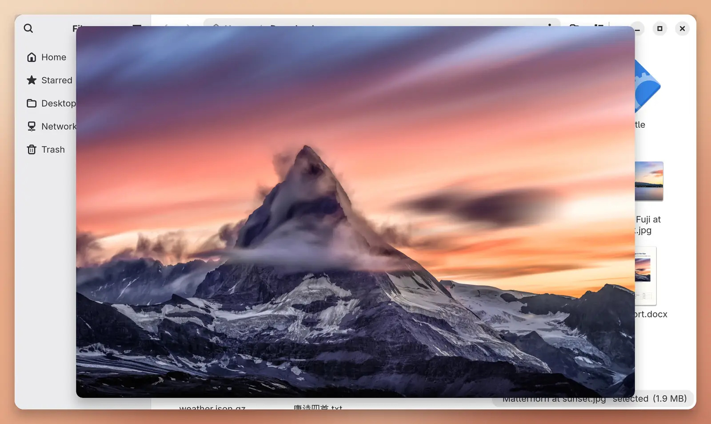
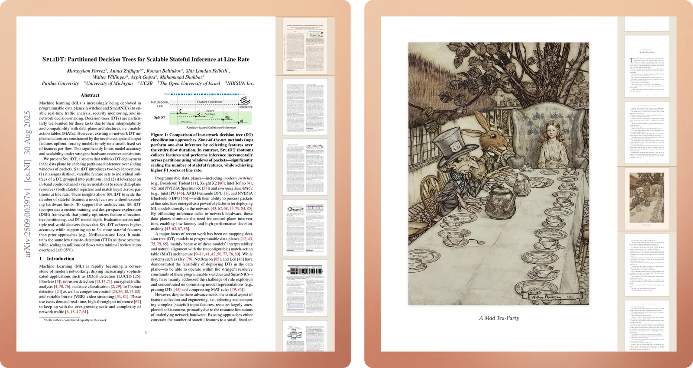
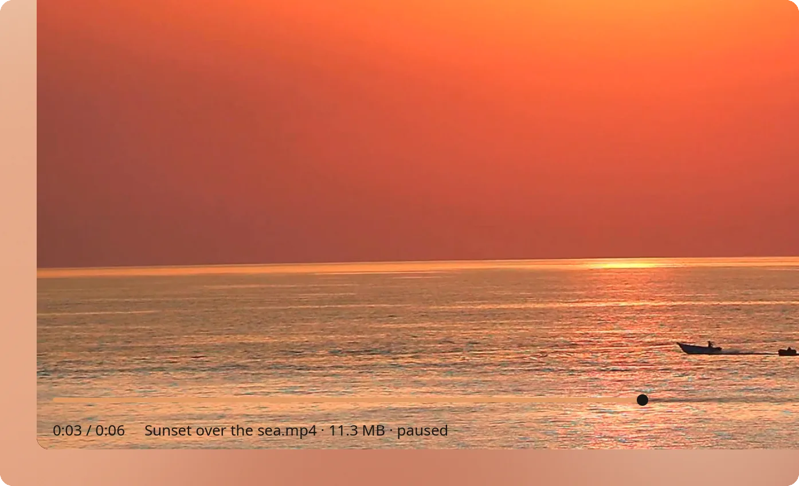
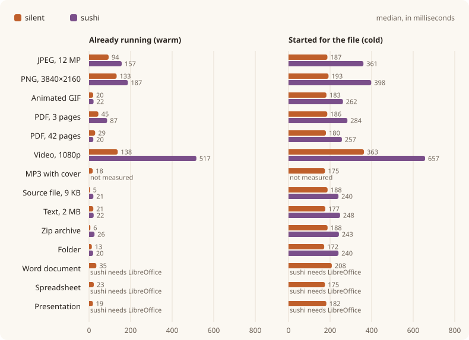
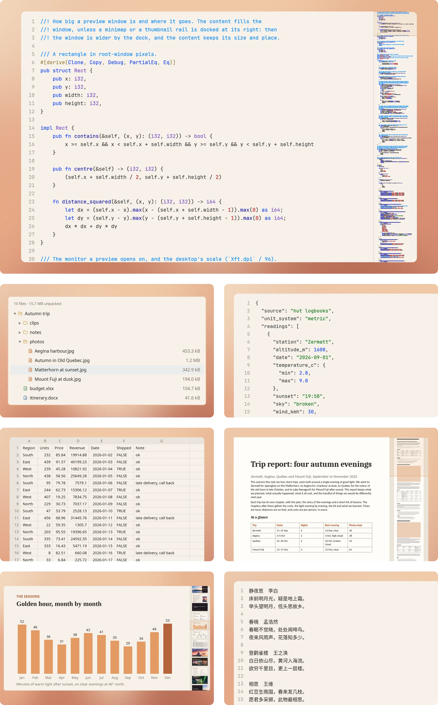
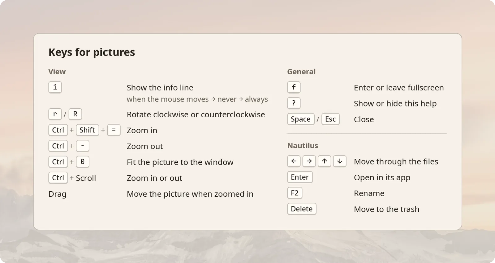

<p align="center">
  <picture>
    <source media="(prefers-color-scheme: dark)" srcset="docs/silent-header-dark.png">
    
  </picture>
</p>

<p align="center">
  A borderless file previewer for Nautilus on X11, in place of GNOME's sushi.
</p>

<p align="center">
  <a href="https://crazyboycjr.github.io/silent/">Homepage</a> ·
  <a href="#install">Install</a> ·
  <a href="docs/formats.md">Formats</a> ·
  <a href="docs/usage.md">Keys and views</a> ·
  <a href="docs/integration.md">File managers</a> ·
  <a href="docs/benchmark.md">Benchmark</a> ·
  <a href="CHANGELOG.md">Changes</a>
</p>

<picture>
  <source media="(prefers-color-scheme: dark)" srcset="site/media/readme-space-dark.webp">
  
</picture>

## No border

There is no title bar, no frame and no buttons: the window is the file, a photo edge to edge with gently rounded corners, or a Word document as a column of paper, with the square corners paper has.

<picture>
  <source media="(prefers-color-scheme: dark)" srcset="site/media/no-border-pair-dark.webp">
  
</picture>

## Paper

A paper or a book in PDF opens at its first page, in a window shaped by it, square as paper. The pages follow in a scroll, drawn as they come into view, with their thumbnails docked at the right; the wheel scrolls, a page number and <kbd>G</kbd> goes straight to that page, and <kbd>Ctrl</kbd> with the wheel zooms where the pointer is.

<picture>
  <source media="(prefers-color-scheme: dark)" srcset="site/media/readme-paper-dark.webp">
  
</picture>

## Minimal

Move the mouse and one line of facts, the info line, fades in over the bottom of the preview, on a veil only as dark as its words need; rest, and it fades out. Over a video it comes with the playbar.

<picture>
  <source media="(prefers-color-scheme: dark)" srcset="site/media/minimal-video-dark.webp">
  
</picture>

## Blazing fast

silent starts with Nautilus and keeps its window and its GPU device ready, so each preview opens at its final size, with the file drawn within a frame or two: a source file about 5 ms after Nautilus asks, and a PDF in 30 to 45. Staying resident has a cost in memory: showing one file, silent's process holds about 170 to 260 MB (450 for a video), and it stays as long as Nautilus runs; the [memory table](docs/benchmark.md#switching-files-and-memory) has each file.

<picture>
  <source media="(prefers-color-scheme: dark)" srcset="docs/benchmark-dark.svg">
  
</picture>

Measured against GNOME's sushi on 2026-10-29, the median of five runs from Nautilus's call to the first frame on X11 with an NVIDIA RTX 4070 SUPER, silent was faster on every file from a cold start and on most files warm; the numbers, how they were taken and how to run the bench yourself are in [docs/benchmark.md](docs/benchmark.md).

## Smarter, broader format support

Code comes highlighted with a minimap, archives open as a tree you can preview inside, Word, Excel and PowerPoint files open without an office suite, gzipped JSON comes out laid out, and Chinese in GBK reads right. Every format is in [docs/formats.md](docs/formats.md).

<picture>
  <source media="(prefers-color-scheme: dark)" srcset="site/media/readme-formats-dark.webp">
  
</picture>

## Keys

Press <kbd>?</kbd> and a card lists the keys for the file in front of you, silent's own first. The cards for code, PDFs and videos, and every key, are in [docs/usage.md](docs/usage.md).

<picture>
  <source media="(prefers-color-scheme: dark)" srcset="site/media/keys-photo-card-dark.webp">
  
</picture>

## Install

silent runs on **X11 only**; it does not run on Wayland yet. It needs a Vulkan driver, glycin's image loaders with bubblewrap, GStreamer for video and sound, libarchive, and the fonts Noto Sans and JetBrains Mono.

On Arch Linux, from this repository, until silent is on the AUR:

```sh
git clone https://github.com/crazyboycjr/silent
cd silent/packaging/arch
makepkg -si
```

The package installs `/usr/bin/silent` and the D-Bus services Nautilus and Nemo call, `org.gnome.NautilusPreviewer` and `org.nemo.Preview`, in place of sushi's and nemo-preview's; the next Space starts silent, with no restart.

With Nix, `nix build` in a clone leaves silent in `result/`, and this installs it, with the same services:

```sh
nix profile install github:crazyboycjr/silent
```

A Nix-built silent reaches the GPU's Vulkan driver by itself only on NixOS, where the package goes in `services.dbus.packages` for Nautilus to start it, and its fonts in `fonts.packages`; on other distributions it needs [nixGL](https://github.com/nix-community/nixGL), as [docs/development.md](docs/development.md#nix) explains.

Without a package, build it with `cargo build --release` and point Nautilus's service at the binary, as [docs/development.md](docs/development.md) shows.

A tiling window manager should float silent's windows, whose class is `silent`. In xmonad, with the layout wrapped in `smartBorders`, or `lessBorders` with a policy, from `XMonad.Layout.NoBorders`:

```haskell
className =? "silent" --> hasBorder False <+> doCenterFloat
```

## File managers and the terminal

Nautilus and Nemo preview with silent when you press Space. In a terminal, `silent FILE` previews a file on its own, and `silent show FILE` and its kin talk to the previewer that runs beside Nautilus, starting it if need be. That is how yazi's plugin, ranger, lf and nnn preview with silent; [docs/integration.md](docs/integration.md) shows how to set each one up.

Tested with Nautilus 51, Nemo 6.6, yazi 26.9, ranger 1.9, lf 42 and nnn 5.3. The setups for Thunar, PCManFM and Dolphin are written down but not tested.

## Built with Rust and GPUI

silent is written in Rust on [GPUI](https://www.gpui.rs), the toolkit of the Zed editor, through [gpui-kit](https://crates.io/crates/gpui-kit), and draws with Vulkan. HTML is laid out by [Blitz](https://github.com/DioxusLabs/blitz), PDFs are drawn by [hayro](https://github.com/LaurenzV/hayro), most pictures are decoded by [glycin](https://gitlab.gnome.org/GNOME/glycin), and video and sound play through [GStreamer](https://gstreamer.freedesktop.org). Building it and the test harness are in [docs/development.md](docs/development.md).

## License

silent is licensed under the Apache License, Version 2.0; see [LICENSE](LICENSE). The photographs and the video in its screenshots are in the public domain (CC0), from Wikimedia Commons. The paper is [SpliDT: Partitioned Decision Trees for Scalable Stateful Inference at Line Rate](https://arxiv.org/abs/2509.00397) by Murayyiam Parvez, Annus Zulfiqar, Roman Beltiukov, Shir Landau Feibish, Walter Willinger, Arpit Gupta and Muhammad Shahbaz, under [CC BY 4.0](https://creativecommons.org/licenses/by/4.0/). The book is Lewis Carroll's *Alice's Adventures in Wonderland* with Arthur Rackham's illustrations of 1907, both in the public domain, set for these screenshots from a public-domain transcription and scans on Wikimedia Commons.
